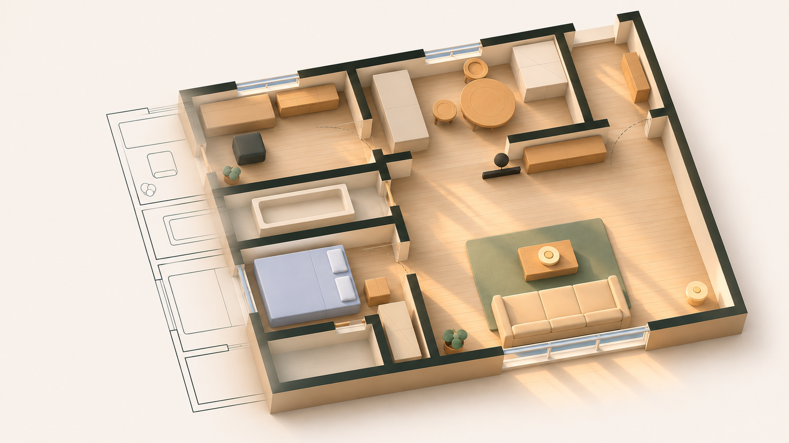

# Room Simulator



[한국어](README.md) | **English**

A browser-based 3D interior planner: draw or trace a floor plan, furnish it,
and inspect the result in a first-person walkthrough or a dollhouse bird's-eye
view.

The core design decision is a single plan model (SSOT) from which the 2D
editor, both 3D views and the shopping list are all derived. Any change made in
any view — moving furniture, opening a door, switching a lamp, changing a floor
finish — mutates the same model, with command-level undo and debounced
localStorage persistence. The project implements an 8-screen design handoff
spec.

## Tech stack

| Area | Stack |
|---|---|
| Framework | React 18 + TypeScript (strict) |
| Build | Vite |
| 2D editor | Hand-rolled SVG rendering (no canvas library) |
| 3D | Three.js 0.170 · React Three Fiber 8 · Drei 9 |
| State | Zustand 5 (single store, command-level undo) |
| Tests | Vitest (pure logic only) |
| Persistence | localStorage + JSON export/import |

## Features

| Screen | Summary |
|---|---|
| 2D floor plan editor | Wall/door/window drawing, furniture placement with grid and wall-face snapping, 15° rotation, multi-select, collision and door-clearance warnings, persistent dimension notes, per-room floor and wall finishes |
| 3D walkthrough | First-person WASD movement (capsule collision with sliding response), gaze interaction — toggle lamps and the TV, open and close hinged/sliding doors, edit materials |
| Bird's-eye view | Dollhouse / section / orthographic cameras, lighting simulation (time-of-day presets, window orientation), enter the walkthrough from any viewpoint |
| Upload | Drop a floor plan image and it opens as an editable plan right away — walls and rooms are auto-detected (straight walls come out square, 45° outer walls stay diagonal); doors and windows are detected only where a wall line breaks, the rest are placed with the editor's door/window tools; scale calibration and re-detection live in the editor |
| Apartment templates | Studio (23㎡), 59㎡ and 84㎡ Korean apartment layouts — net (inner-face) areas, furnished |
| Dashboard | Plan list (rename/duplicate/delete), shopping list — prices shown only for items linked to verified products, JSON backup |
| Link sharing | Share a plan as a link that carries the plan in the URL hash — the recipient opens it read-only in 2D and 3D with nothing to install, then "Copy to my plans" to edit. No server storage |

The furniture catalog spans categories from sofas and bedrooms to appliances,
and some items are linked to real products (price, dimensions, store link).
Picture frames, wall clocks, wall mirrors and wall-mounted air conditioners
mount on walls via a wall-segment coordinate system.

## Running

```bash
npm install
npm run dev      # dev server
npm run build    # tsc + vite build
npm test         # vitest (pure-logic tests)
```

Designed for desktop at 1440×900; responsive layout is out of scope. There is
no backend — plans persist in browser localStorage. The 3D views require WebGL.

## Documentation

- [docs/ARCHITECTURE.md](docs/ARCHITECTURE.md) — the SSOT plan model, how 2D
  and 3D derive from it, state shape, multi-floor and persistence design,
  input routing rules (Korean)
- [docs/DECISIONS.md](docs/DECISIONS.md) — measurement-backed decision log:
  why auto-detection features were rejected, with samples, numbers and dates
  (Korean)
- [docs/STATUS.md](docs/STATUS.md) — implementation ledger kept during
  multi-session development (Korean)

## License

Source-available (all rights reserved) — published for reading and educational
reference. See [LICENSE](LICENSE) for details.
